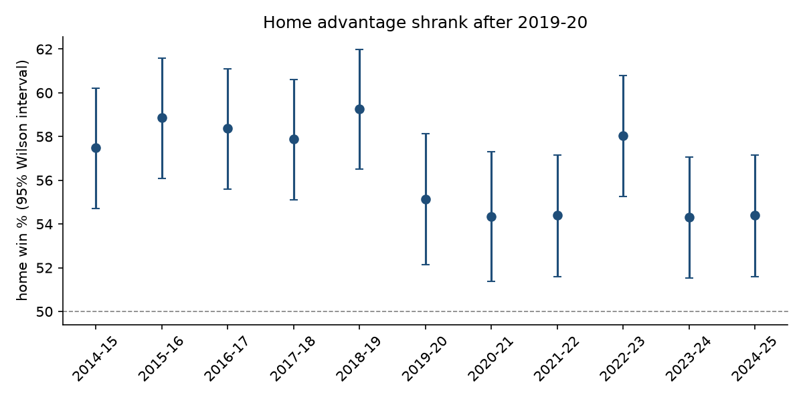
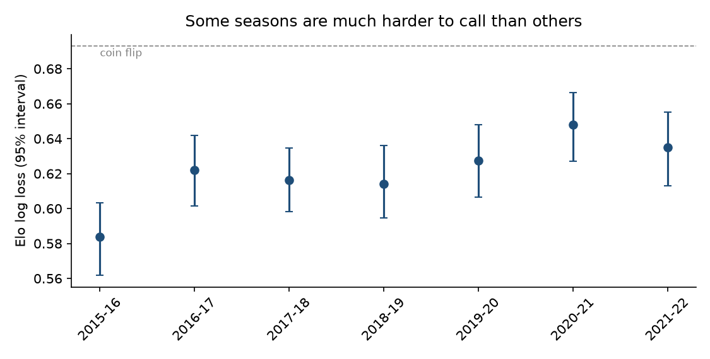
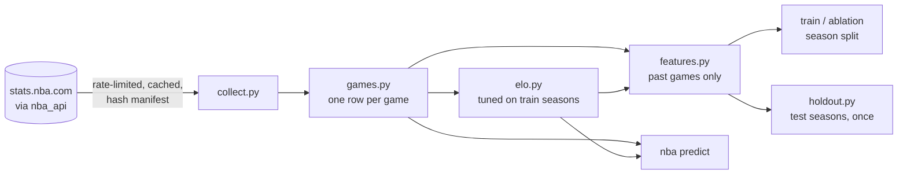

# nba-match-predictor

The probability that the home team wins an NBA regular-season game, using only what was known before tip-off.

The point is to do time-series prediction without leaking the future:
- every rolling stat and rating is built from earlier games only, and tests prove it;
- models are compared on log loss with paired intervals, not on accuracy;
- the last three seasons were scored once, at the end.

**Result:** a from-scratch Elo rating gets **64.9%** of 3,690 test-season games right (95% CI 63.4 to 66.5), with log loss 0.624. Logistic regression and gradient boosting on 12 features couldn't measurably beat it. The one addition that helped, a back-to-back adjustment, was declared before the test set was opened, and the test seasons confirmed it.

## Demo

```text
$ uv run nba predict --home BOS --away NYK --date 2025-03-01
NYK at BOS on 2025-03-01 (at BOS)
  BOS win probability: 68%  (Elo 1671 vs 1599)
  ratings use games up to 2025-02-28
  note: BOS, NYK played the day before. Plain Elo ignores this; on validation, tired teams did a few points worse than Elo said.

$ uv run nba predict --home BOS --away BOS
error: a team can't play itself
```

`--neutral` drops the home bonus, and `--json` prints the result as JSON. Predictions only use the cached games before the given date, and the CLI never calls the NBA's servers.



## Results

Validation (2020-21 and 2021-22, 2,310 games):

| Model | Log loss | Accuracy |
|---|---|---|
| Always home | 0.692 | 54.4% |
| Better record so far (log5) | 0.653 | 61.1% |
| **Elo (from scratch)** | **0.641** | 63.6% |
| Logistic regression, 12 features | 0.642 | 63.4% |
| Gradient boosting, 12 features | 0.642 | 64.3% |
| Elo + back-to-back adjustment | 0.639 | 63.6% |

Test (2022-23 to 2024-25, 3,690 games, scored once):

| Model | Log loss | Accuracy |
|---|---|---|
| Always home | 0.688 | 55.6% |
| **Elo (what the CLI uses)** | **0.624** (0.612 to 0.636) | **64.9%** (63.4 to 66.5) |
| Elo + back-to-back adjustment (declared beforehand) | 0.621 | 65.6% |

On test, the adjustment beats plain Elo by 0.0013 to 0.0041 log loss, an interval clear of zero. The CLI still uses plain Elo, because switching after seeing the test score would mean choosing the model on the test set. It's the obvious next step.

What the work found:

- **Home advantage shrank.** Home teams won 58.4% of games from 2014-15 to 2018-19 and 55.1% from 2020-21 on. The drop started before COVID: 2019-20 before the bubble was already 55.1%. The 88 bubble games are too few to say anything (45% to 66%).
- **Elo carries the old home edge.** It was tuned on seasons with a 58% home rate, so on later seasons it predicts about 57.5% where home teams won 54 to 56%. That costs little: even the best possible shift, fitted on validation, gains only 0.003 log loss.
- **The features mostly repeat Elo.** Season-to-date margin, win %, form and ratings add nothing once Elo is in, and slightly hurt. Without Elo, log loss is clearly worse (0.658).
- **Back-to-backs are the exception.** In the training seasons, when only the away team played the night before, home teams won about 4 points more than Elo expected, and about 4 points less when only the home team did. The model learned this, but its old home edge cancelled the gain on validation.
- **The season matters more than the model.** Elo's log loss runs from 0.584 (2015-16) to 0.648 (2020-21) between seasons, against model differences of about 0.002.
- **Two data surprises:**
  - neutral-site games (Paris, Mexico City, the NBA Cup semifinals) write both team rows as "away @ home", which broke the first home/away parser;
  - a "changed" stat between two downloads turned out to be a missing value compared as text.



## Features

- `nba predict`: home win probability from plain Elo, for any date covered by the cache, with back-to-back status shown.
- `nba holdout`: scores the test seasons and refuses to run a second time.
- Leakage tests:
  - cut the data at a date, rebuild, and nothing before the cut may change;
  - change one result, and nothing up to that date may change. The test also checks that later games do change, so it can fail.
- The collector caches the raw API responses with SHA-256 hashes, checks their schema, rate-limits requests, and reports what changed on a refresh. CI never calls the API.
- Models are saved with a hash manifest and loaded only from the checked bytes.

## Stack

Python 3.12, uv, pandas, scikit-learn, scipy, nba_api, matplotlib, pytest, ruff. CI: GitHub Actions with ruff, pytest, a CLI smoke test, pip-audit and Gitleaks.

## Architecture



Twelve decisions with their reasons, plus a STRIDE threat model, are in [docs/ARCHITECTURE.md](docs/ARCHITECTURE.md).

## Data

Team game logs from stats.nba.com through [nba_api](https://github.com/swar/nba_api) (MIT), an unofficial client. There are 11 regular seasons (2014-15 to 2024-25), 13,209 games, and none were dropped. The data is subject to NBA.com's terms of use: it's downloaded by a script, used for this non-commercial project, and never committed or re-hosted. Test fixtures are made-up games.

## Quick start

```bash
uv sync
make data       # downloads 11 seasons once (under a minute), cached in data/raw
make games      # one row per game: data/processed/games.parquet
make elo        # tunes Elo on the training seasons: reports/elo.json
make features   # pre-game features from earlier games only: data/processed/features.parquet
uv run nba predict --home BOS --away NYK --date 2025-03-01
make lint test
```

`make baselines`, `make train` and `make ablation` rerun the validation comparisons.

## Structure

```text
src/nba_predictor/  collect, games, features, elo, evaluate, baselines, train, ablation, holdout, cli
notebooks/          01 home advantage · 02 features · 03 rest and Elo · 04 baselines · 05 models · 06 ablation · 07 seasons and upsets
reports/            JSON results (including holdout.json) and figures
tests/              110 tests, including the leakage tests, bad API responses and CLI errors
docs/               ARCHITECTURE.md
```

## Limitations

- **No player availability.** A game where a star sits out looks the same as one where he plays. This is the biggest missing piece.
- **No betting odds**, the strongest public benchmark. There's no free source whose licence allows this use.
- **The home edge is fixed** at what the training seasons showed (60 Elo points), which is too big for recent seasons.
- **Elo uses scores** (margin of victory), so "form adds nothing" holds next to this Elo. It might not hold next to a win/loss-only rating.
- **The bootstrap resamples games independently.** Games in a season share teams, so the true intervals are a little wider.
- **Neutral-site games before 2024-25** (London, Mexico City) aren't flagged, because the API writes them like normal home games. Elo gives them a home bonus they didn't have.
- **The source is unofficial and can change,** and its terms rule out commercial use. It isn't betting advice.

## License

MIT
