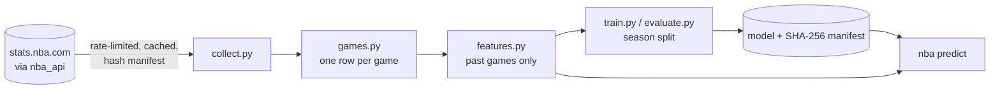

# Architecture

## Context

An offline ML project on one laptop. Before tip-off, it predicts the probability that the home team wins an NBA regular-season game, using only what was known before that game.

Most of the work is doing time-series features without leaking the future:

1. **Collect** team game logs for the 2014-15 to 2024-25 regular seasons through `nba_api`, with caching and polite rate limits.
2. **Build one row per game.** The API returns one row per team per game. Measure home advantage, including the 2019-20 bubble with no crowds.
3. **Features from past games only:** rolling form, rest days, back-to-backs, and an Elo rating written from scratch. Tests prove that no feature for a game uses that game or anything later.
4. **Evaluate by season.** Train on early seasons, tune on the next two, and score the last three once. The product is a probability, so log loss and Brier score lead, with accuracy shown next to them.

The output is a reproducible pipeline, notebooks, reports, and an `nba` CLI.

## Data

| Item | Choice | Notes |
|---|---|---|
| Source | `nba_api` (MIT), an unofficial client for stats.nba.com. Endpoint `LeagueGameFinder`, one call per season, regular season only | Free, no key. Unofficial, so it can change or block without notice |
| Seasons | 2014-15 to 2024-25: 11 seasons, about 13,000 games | Modern era only, so the older, slower game doesn't blur the features. 2019-20 (bubble, about 1,060 games) and 2020-21 (72 games a team, limited crowds) are kept and reported separately |
| Terms | NBA.com terms of use: personal, non-commercial use | The data is never committed or re-hosted. A script downloads it to `data/` (git-ignored). Test fixtures are made-up games, not NBA data |
| Reproducibility | Raw JSON cached per season, with its SHA-256 and download date in a manifest | Stats.nba.com can revise old rows. A new download is compared with the manifest and the differences are reported, not trusted blindly |

**Not included:** betting odds. They would be the real benchmark, but there's no free source whose licence allows this use. The README names this as the main missing comparison. Player availability (injuries, rest, trades) is also out of scope, and it's the biggest known limitation.

## Known problems (to measure, not hide)

- **Leakage through rolling stats.** A rolling mean that includes tonight's game, or a season average over the whole season, gives high accuracy for free. Every feature is built with `shift(1)` within each team. A test deletes a game and everything after it, rebuilds the features, and checks that the remaining rows don't change.
- **Same-day games.** Only games on strictly earlier dates count, never one from earlier the same evening.
- **Home advantage changed over time.** It has shrunk across the period and nearly vanished in the bubble. Elo's home bonus is tuned on validation and checked per season.
- **Team identity.** No team moved or was renamed in this range (the Pelicans and Hornets renames happened in 2013 and 2014), but teams are still keyed by `TEAM_ID`, never by name or abbreviation, so a wider range wouldn't break.
- **Each game must appear exactly twice** in the raw data (once per team) with opposite results and matching dates. Games that don't are counted and dropped, and if there are more than a handful the build fails.

## Setup

| Item | Choice | Why |
|---|---|---|
| Split | Train 2014-15 to 2019-20; validation 2020-21 and 2021-22; test 2022-23 to 2024-25, scored once | Time order. A random split would let a model learn a team's season from its future games |
| Metrics | Log loss, Brier score, a reliability curve, accuracy; per-season results with bootstrap intervals; paired comparisons between models | One season (about 1,230 games) has a 95% accuracy interval of roughly ±2.7 points, so single-season differences need care |
| Baselines | Always pick home; the better win % so far this season; Elo alone | A model has to beat Elo to be worth its complexity |
| Elo | From scratch: K, home bonus and the between-season pull toward the mean, tuned on the training seasons (2014-15 as burn-in); no home bonus on neutral courts or in the bubble | Small, explainable, and hard to beat. Tuning on training keeps validation clean for comparing models |
| Models | Logistic regression and gradient boosting (scikit-learn's `HistGradientBoostingClassifier`); calibration checked, not assumed | A simple model may well be enough. The ablation shows which features earn their place |

## Components

| Component | Responsibility |
|---|---|
| `collect.py` | One request per season, at least 1 s between requests, a 60 s timeout (the first request of a session took 23 s), 3 tries with backoff for transport errors (a bad response isn't retried), a 20 MB cap, cache plus manifest. `--refresh` downloads again and reports rows added, removed and changed. Never called in CI |
| `games.py` | Team rows to one game row (home and away from the `MATCHUP` text, "vs." and "@"), with the two-rows-per-game check. More than 3 unreadable games in a season fails the build. Neutral-site games (both rows "away @ home") and bubble games are flagged |
| `features.py` | Games played, win %, average margin, 10-game form, offensive and defensive rating so far this season; rest, back-to-backs and Elo (day 5). Past games only. First-game placeholders are neutral values, and the league rating comes from earlier dates only, never the whole table |
| `train.py` / `evaluate.py` | Season split, baselines, models, calibration, bootstrap, run metadata |
| `model_store.py` | Hash-checked model save and load: the pickle is only loaded from bytes whose SHA-256 matches |
| `cli.py` | `nba predict --home BOS --away NYK --date 2025-03-01` from cached data; `nba holdout`, run once |

## Decisions

| # | Decision | Why |
|---|---|---|
| 1 | Regular seasons 2014-15 to 2024-25 only | Agreed scope. It's the modern pace-and-space era, and playoffs follow different dynamics with fewer games |
| 2 | Split by season: 6 train, 2 validation, 3 test | Predictions are always about the future. Three test seasons give about 3,700 games, for a 95% accuracy interval of about ±1.5 points |
| 3 | Log loss and Brier score are the main metrics | The CLI outputs a probability, so it has to be calibrated, not just right more often than not |
| 4 | Every feature is shifted per team and computed only from strictly earlier dates, with a deletion test | Leakage is the main way this kind of project fools itself |
| 5 | Elo is written from scratch, with its parameters tuned on the training seasons. Result: K 15, home bonus 60, carry-over 0.8, margin of victory on | It's a strong baseline, and building it shows how the rating updates. Changed from "tuned on validation" (day 5) so validation is only used once, to compare models |
| 6 | No player, injury or odds data | No free, licensed source, and out of scope for 10 days. It's listed as the main limitation |
| 7 | The raw API responses are cached with hashes; CI never calls the API | Polite to the source, reproducible, and CI runners are often blocked by stats.nba.com |
| 8 | Teams are keyed by `TEAM_ID` | Names and abbreviations can change, even if none do in this range |
| 9 | The test seasons are scored once, by a command that refuses a second run | Tuning after seeing the test score would turn it into one more validation set |
| 10 | Models are saved with a SHA-256 manifest and loaded only from the checked bytes | A pickle runs code when loaded |
| 11 | A model replaces Elo only if it beats Elo's validation log loss with a paired 95% interval clear of zero | On day 7, logistic regression and boosting with every feature landed within 0.004 of Elo (0.6418 vs 0.6411, interval −0.003 to +0.004). Without a measurable gain, the simpler model wins |
| 12 | The CLI uses plain Elo. Plain Elo plus a back-to-back adjustment (Elo's log-odds kept fixed, only the shifts learned) is declared before the test set is opened as the one secondary model scored on it | Day 8 ablation: rest adds information (−0.0052 to −0.0009 inside the regression), but against plain Elo the adjustment's interval is −0.0038 to +0.0001, short of decision 11's bar. Form features add nothing once Elo is in |

## Threat model (STRIDE)

The system is offline: no service, no accounts, no secrets. The risks are in the data coming in and the files on disk.

| | Threat | Mitigation |
|---|---|---|
| Spoofing | A tampered or wrong API response | HTTPS only, and a strict schema check on every response (columns, types, two rows per game) |
| Tampering | The cached data or the model file is changed | A SHA-256 manifest for the cache; the model is loaded only from hash-checked bytes (decision 10) |
| Repudiation | A number can't be traced to its data | Run metadata (git commit, cache hashes, download dates) is saved with every result |
| Information disclosure | Little: public team stats, no secrets, no personal data beyond public team names | `.env.example` holds only optional settings |
| Denial of service | Hammering stats.nba.com gets the laptop blocked; a huge or malformed response hangs the build | Rate limit, cache, timeouts, a response size cap, and no network calls in CI |
| Elevation (misuse) | Used as betting advice | The README says it isn't. It shows calibration and per-season variance, and there's no odds integration |

## Limitations (known before starting)

- No player availability, so a game where a star sits out looks the same as one where he plays.
- No betting odds, which are the strongest public benchmark.
- About 1,230 games a season, so single-season results are noisy.
- The source is unofficial and can change, and its terms rule out commercial use.
